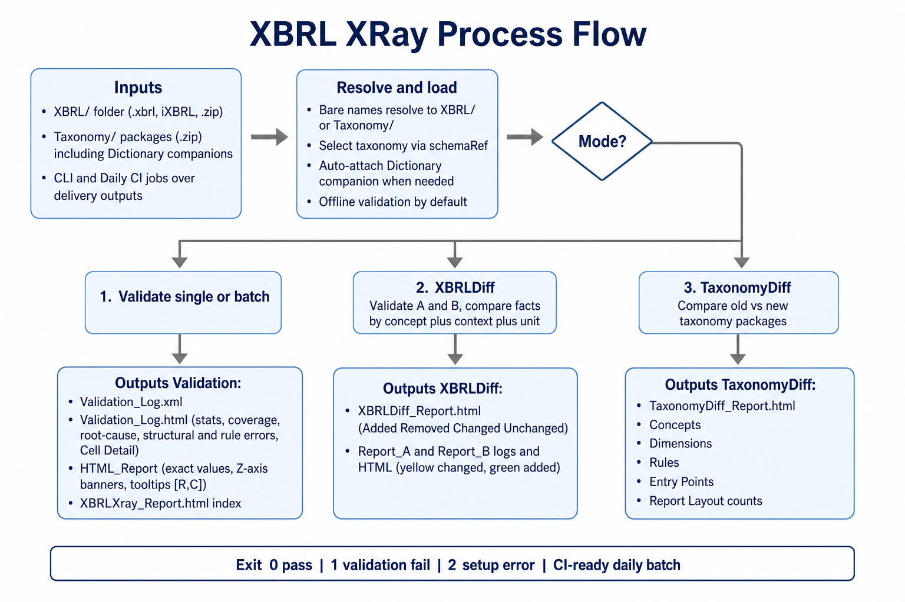

# XBRLXray

Validate Bank of England (BOE) Statistics XBRL/iXBRL filings with [Arelle](https://arelle.org/), then produce readable validation and HTML table outputs — including side-by-side **XBRLDiff** when comparing two filings.

## Process flow



| Stage | What happens |
|--------|----------------|
| **Inputs** | Instance files from `XBRL/` (`.xbrl`, iXBRL, or `.zip`) and taxonomy packages from `Taxonomy/`. CLI or **daily CI jobs** scan delivery outputs. Modes: **validate**, **`--xbrl-diff`**, **`--taxonomy-diff`**. |
| **Resolve & load** | Bare filenames resolve under `XBRL/` or `Taxonomy/`. Taxonomy package is selected from each instance `schemaRef`; EBA-style filings also auto-load the matching **Dictionary** companion. Validation runs offline by default (`--online` to allow downloads). |
| **Validate** | Structural and formula/DQ checks run. Stats, cell coverage, and fact→cell mapping are collected. |
| **Outputs (validate)** | `Validation_Log.xml`, `Validation_Log.html` (stats, coverage, root-cause, Cell Detail), `HTML_Report/` tables, and `XBRLXray_Report.html` index. |
| **Outputs (XBRLDiff)** | Per-side logs/HTML under `Report_A/` / `Report_B/`, plus `XBRLDiff_Report.html` and highlight colours on Report B tables. |
| **Outputs (TaxonomyDiff)** | `TaxonomyDiff_Report.html` — Concepts, Dimensions, Rules, Entry Points, Report Layout (Added / Removed / Changed). |

Exit codes: **`0`** all passed · **`1`** one or more validation failures · **`2`** runtime / setup error.

---

## What XBRLXray does

| Capability | Detail |
|------------|--------|
| **Automatic taxonomy** | Picks the matching package from `Taxonomy/` using the instance entry point / `schemaRef`. For EBA-style filings, also auto-loads the matching **Dictionary** companion package (reporting frameworks alone leave report cells empty). |
| **Structural + rule validation** | Separates taxonomy/dimension/schema issues from formula / DQ assertion failures. |
| **Readable Validation Log** | HTML with stats, coverage, root-cause tree, troubleshooting, and **Cell Detail** (`row\|col`). |
| **HTML table report** | Taxonomy tables filled with **exact** instance lexical values (not rounded display). |
| **Cell tooltips** | Hover/focus any data cell for metric, dimensions, and coordinates like `[0760, 0010]`. |
| **Z-axis banners** | Multi-value Z slices (e.g. currency) get clear section banners in the HTML tables. |
| **Viewport scrolling** | Wide/tall tables scroll inside the browser viewport (horizontal + vertical scrollbars stay usable). |
| **XBRLDiff** | Compare two filings: fact Added / Removed / Changed / Unchanged; B HTML cells highlighted. |
| **TaxonomyDiff** | Compare two taxonomy packages: Concepts / Dimensions / Validation Rules Added·Removed·Changed. |
| **Zip instances** | Accepts compressed filings; extracts the XBRL/iXBRL member automatically. |
| **Bare filenames** | `--xbrl`, `--xbrl-diff`, and `--taxonomy-diff` resolve bare names from `XBRL/` or `Taxonomy/`. |

---

## Requirements

- **Python 3.10+** (tested with Python 3.13)
- Taxonomy package zip(s) in `Taxonomy/`
- XBRL/iXBRL instance file(s) — plain `.xbrl` or `.zip` — in `XBRL/` (or pass an explicit path)

## Installation

From the `XBRLXray` folder:

```bash
py -3 -m venv .venv
.\.venv\Scripts\Activate.ps1
py -3 -m pip install -r requirements.txt
```

## Folder layout

```text
XBRLXray/
  XBRL/                       ← .xbrl / iXBRL / .zip instances
  Taxonomy/                   ← taxonomy package .zip files
  Output/                     ← one subfolder per run (created automatically)
  validate_xbrl.py
  XBRLXray_Process_Flow.png   ← process-flow diagram
  ReadMe.html                 ← on-prem HTML user guide (open in browser)
  ReadMe.md
```

### Compressed (zip) instances

Place the zip in `XBRL/` or pass it with `--instance` / `--xbrl`.  
XBRLXray extracts the member automatically (prefers `.xbrl`, then `.xhtml`/`.html`, then `.xml`).

```bash
py -3 validate_xbrl.py -i XBRL\big-filing.zip --no-html-report
```

---

## How to run

### Batch mode (all files in `XBRL/`)

```bash
py -3 validate_xbrl.py
```

### Single file

Bare names resolve from `XBRL/` next to `validate_xbrl.py`:

```bash
py -3 validate_xbrl.py --xbrl "PRA101 Capital Plus.xbrl"
py -3 validate_xbrl.py -i ad.xbrl
```

Full paths also work:

```bash
py -3 validate_xbrl.py -i XBRL\CC.20260601_20260807135250000.xbrl
py -3 validate_xbrl.py --xbrl "C:\path\to\PRA Memorandum.xbrl"
```

### Compare two files (XBRLDiff)

```bash
py -3 validate_xbrl.py --xbrl-diff CC_PreFix.xbrl CC_PostFix.xbrl
py -3 validate_xbrl.py --xbrl-diff "ad.xbrl" "ad - Copy.xbrl"
```

### Compare two taxonomy packages (TaxonomyDiff)

Bare filenames resolve from `Taxonomy/` next to `validate_xbrl.py` (1st = old/existing, 2nd = new/upcoming):

```bash
py -3 validate_xbrl.py --taxonomy-diff boe-statistics-taxonomy-v130.zip boe-statistics-taxonomy-v131.zip
```

Full paths also work:

```bash
py -3 validate_xbrl.py --taxonomy-diff "C:\path\old.zip" "C:\path\new.zip"
```

Writes under `Output/TaxonomyDiff_<old>_vs_<new>/`:

- `TaxonomyDiff_Report.html` — Concepts / Dimensions / Validation Rules Added·Removed·Changed

### Command-line options

| Option | Description |
|--------|-------------|
| `--xbrl` | File (single run) or folder of files. Bare names → `XBRL/`. |
| `--instance` / `-i` | Same as `--xbrl <file>`. |
| `--taxonomy-diff OLD NEW` | Compare two taxonomy `.zip` packages (old vs new). Bare names → `Taxonomy/`. |
| `--xbrl-diff FILE_A FILE_B` | Compare two filings (Report A vs Report B). |
| `--xbrl-dir` | Batch input folder (default: `./XBRL`). |
| `--taxonomy-dir` | Taxonomy zip folder (default: `./Taxonomy`). |
| `--output-dir` | Output root (default: `./Output`). |
| `--online` | Allow internet downloads (default: offline). |
| `--no-html-report` | Skip HTML table report (validation logs still written). |

---

## Outputs

### Single / batch validation

```text
Output/
  <fileStem>/
    XBRLXray_Report.html     ← open this first (links into HTML_Report/)
    Validation_Log.html      ← readable validation findings
    Validation_Log.xml       ← Arelle XML log (source for HTML details)
    HTML_Report/
      index.html
      boe_tCP01.00.01.01.html
      ...
    _extracted/              ← only when input was a .zip
```

Open `Output/<fileStem>/XBRLXray_Report.html` — no need to enter `HTML_Report/` first.  
That page also links to `Validation_Log.html`.

### XBRLDiff

```text
Output/
  XBRLDiff_<A>_vs_<B>/
    XBRLDiff_Report.html     ← A vs B summary + fact change lists
    Report_A/
      Validation_Log.html
      Validation_Log.xml
      HTML_Report/ ...
      XBRLXray_Report.html
    Report_B/
      ...                    ← same layout; cells highlighted vs A
```

### TaxonomyDiff

```text
Output/
  TaxonomyDiff_<old>_vs_<new>/
    TaxonomyDiff_Report.html   ← Concepts / Dimensions / Rules summary + detail
```

---

## Validation Log (`Validation_Log.html`)

Human-readable report of ERROR-level findings after Arelle validation.  
Companion file `Validation_Log.xml` is the raw Arelle log used to drive the HTML.

### Section overview (top → bottom)

```text
Validation Log
├── Taxonomy applied (includes Instance path)
├── Validation rule stats
├── Cell coverage
├── Error Root-Cause Analysis
├── Structural Error(s)          ← taxonomy / dimension / schema
└── Validation rule failures     ← formula / DQ assertions
```

### 1. Taxonomy applied

Shows the filing path and which package XBRLXray selected.

| Field | Meaning |
|-------|---------|
| **Instance** | Path of the XBRL/iXBRL file that was validated. |
| **Taxonomy applied / name / version** | Package identity used for validation. |
| **Package file / path** | Zip on disk under `Taxonomy/`. |
| **Publisher / publication date** | Package metadata when available. |
| **Matched entry point** | Entry point resolved from the instance. |
| **Instance schemaRef** | Schema reference found in the filing. |

Error counts (structural vs rule) are not repeated here — see **Error Root-Cause Analysis**.

### 2. Validation rule stats

| Field | Meaning |
|-------|---------|
| **Validation rules (total)** | Assertions present in the applied taxonomy/formula set. |
| **Rules checked** | Assertions that fired at least once for this filing. |
| **Rules passed** | Checked rules with no unsatisfied evaluations. |
| **Rules failed** | Checked rules with one or more unsatisfied evaluations. |
| **Evaluations passed / failed** | Individual assertion evaluation counts (one rule can evaluate many times). |
| **Errors / Warnings** | Message counts from the validation log for this file. |

### 3. Cell coverage

How much of the taxonomy report grid was populated by the instance.

| Field | Meaning |
|-------|---------|
| **Cell coverage %** | `populated ÷ report cells`. |
| **Report cells** | Cells defined by taxonomy tables. |
| **Populated by user/instance** | Cells that have a reported fact (these are what validation can check). |
| **Empty / not populated** | No fact for that metric/dimension combination — not validated for that cell. |
| **Instance facts** | Total facts in the XBRL instance. |
| **Tables counted** | Number of report tables included in the coverage walk. |
| **Per-table table** | Breakdown by table label / ID: cells, populated, empty, %. |

### 4. Error Root-Cause Analysis

Bucketed summary of ERROR findings (non-zero buckets only), for example:

```text
├── 42 errors → Missing dimension
├── 25 errors → Invalid taxonomy concept
├── 18 errors → Incorrect value
├── 10 errors → Missing mandatory fact
└── 5 errors  → Calculation mismatch
```

| Bucket | Typical meaning |
|--------|-----------------|
| **Missing dimension** | Dimension / hypercube / axis mismatch (e.g. `xbrldie:*`). |
| **Invalid taxonomy concept** | Concept/element not in DTS or schema unknown element. |
| **Incorrect value** | Formula / value assertion failed (reported value does not satisfy the rule). |
| **Missing mandatory fact** | Existence / mandatory reporting assertion failed. |
| **Calculation mismatch** | Calculation linkbase / summation inconsistency. |
| **Other** | Did not match the buckets above. |

Each individual error block also shows its assigned **Root cause**.

### 5. Structural Error(s)

Issues that usually mean the instance is wrong against the taxonomy structure (fix these before trusting formula results for the same cells).

| Block field | Meaning |
|-------------|---------|
| **Error code** | Arelle/XBRL code (e.g. `xbrldie:PrimaryItemDimensionallyInvalidError`). |
| **Level** | Severity (`ERROR`, …). |
| **Root cause** | Assigned bucket from the analysis above. |
| **Error detail** | Full message line from validation. |
| **What is the issue?** | Plain-language explanation of the mismatch. |
| **Possible troubleshooting** | Suggested checks (axes, members, metric, context). |
| **Dimensions on fact** | Axis / member pairs present on the fact when available. |
| **Affected fact(s)** | See fact table columns below. |

### 6. Validation rule failures

Formula / DQ assertion messages (often `message:*` codes).

| Block field | Meaning |
|-------------|---------|
| **Rule ID** | Assertion / message identifier. |
| **Level** | Severity. |
| **Root cause** | Assigned bucket. |
| **Validation rule** | Rule expression / test text when available. |
| **Rule source** | Href to the rule definition when available. |
| **Assertion / formula message** | Human message from the formula (often includes the expression). |
| **Affected fact(s)** | Facts involved in the failed evaluation. |

### Affected fact columns (both error types)

| Column | Meaning |
|--------|---------|
| **Label** | Preferential human label for the concept. |
| **QName** | Concept qualified name. |
| **Value** | Reported fact value. |
| **Context** | `contextRef` id. |
| **Cell Detail** | Report coordinates from layout row/column codes, e.g. `0760\|0010` (replaces Entity/Period in the fact list). |
| **Line** | Source line in the instance when available. |
| **Dimensions** | (Structural) Dimension string / pairs on the fact. |

---

## HTML Report (`HTML_Report/` + `XBRLXray_Report.html`)

Rendered taxonomy tables with instance values filled in.

| Feature | Meaning |
|---------|---------|
| **`XBRLXray_Report.html`** | Convenience index next to the validation logs; links into `HTML_Report/`. |
| **`HTML_Report/index.html`** | Table menu for all rendered report tables. |
| **Per-table HTML** | One file per taxonomy table (e.g. `boe_tCP01.00.01.01.html`). |
| **Exact values** | Shows XBRL lexical values (avoids Arelle’s decimals-based rounding in the grid). |
| **Cell tooltips** | Hover, focus, or activate a `td.cell` to see cell id `[R, C]`, row/column labels, metric, and dimensions. |
| **Z-axis banners** | When a table is sliced on Z (e.g. currency), banners mark which slice you are viewing. |
| **Scroll container** | Table scrolls inside the page viewport so both axes stay reachable. |
| **Link to Validation Log** | From the report index / outer HTML when available. |

In **XBRLDiff** mode, Report B tables additionally highlight:

| Colour | Meaning |
|--------|---------|
| **Yellow** | Fact **changed** vs Report A (same identity, different value). |
| **Green** | Fact **added** in Report B (not present in A). |

---

## Taxonomy Difference Report (`TaxonomyDiff_Report.html`)

Produced by `--taxonomy-diff OLD_TAXONOMY NEW_TAXONOMY`.

Loads each package via Arelle (preferring the package **all** entry point) and compares:

| Section | Counts |
|---------|--------|
| **Concepts** | Added / Removed / Changed (type, period, balance, abstract, substitution group, label) |
| **Dimensions** | Added / Removed |
| **Validation Rules** | Added / Removed / Changed (assertion id, test expression, message) |
| **Entry Points** | Added / Removed / Changed (name, description, module; dated path segments normalized) |
| **Report Layout** | Yes/No overall, plus Added / Removed / Modified tables (axis / definition-node structure) |

Example summary block:

```text
Concepts
Added       127
Removed      31
Changed      82

Dimensions
Added        15
Removed       4

Validation Rules
Added        54
Removed      12
Changed      23

Entry Points
Added         2
Removed       0
Changed       1

Report Layout
Changed     Yes
  Added       3
  Removed     1
  Modified    5
```

Detail tables list each id/QName with old vs new attributes where relevant.

---

## Difference Report (`XBRLDiff_Report.html`)

Produced by `--xbrl-diff FILE_A FILE_B`.

**Fact identity** used for matching: **concept + context** (entity / period / dimensions) **+ unit**.

### Layout

1. **Links** — Report B HTML tables, Validation Log A, Validation Log B.  
2. **Report A / Report B cards** — file name, fact count, error count, warning count.  
3. **Detail in 2nd XBRL (Report B vs A)**

| Metric | Meaning |
|--------|---------|
| **Added Facts** | Present in B only. |
| **Removed Facts** | Present in A only. |
| **Changed Facts** | Same identity in A and B, different value. |
| **Unchanged** | Same identity and same value in both. |

4. **Detail tables** — Changed / Added / Removed lists (concept, value A, value B, dimensions; truncated for very large diffs).

Both sides are still fully validated; their own `Validation_Log.html` files remain the place for rule/structural detail.

---

## Typical workflow

1. Put taxonomy zips in `Taxonomy/` and filings in `XBRL/`.  
2. Run `py -3 validate_xbrl.py --xbrl YourFiling.xbrl`.  
3. Open `Output/<stem>/XBRLXray_Report.html` to browse tables and tooltips.  
4. Open `Validation_Log.html` — start with **Root-Cause Analysis**, then structural errors, then rule failures; use **Cell Detail** to jump mentally to `[row, col]` in the HTML table.  
5. To check a fix, run `--xbrl-diff Before.xbrl After.xbrl` and review `XBRLDiff_Report.html` plus yellow/green cells on Report B.
